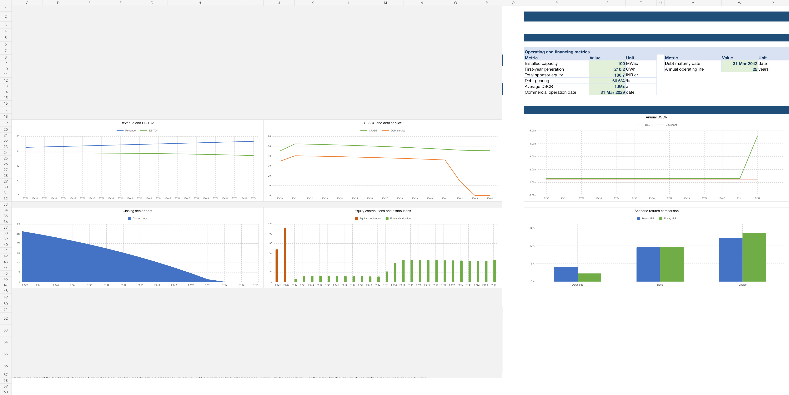

# Infrastructure Project Finance Model

An integrated Excel project-finance model for an illustrative **100 MWac utility-scale solar project in India**. The model covers construction, operations, tax, debt sizing and sculpting, cash waterfalls, investor returns, scenarios, sensitivities, and model assurance.

> **Portfolio purpose:** demonstrate infrastructure and private-markets modelling skills for MSc Finance applications. This is an academic case study, not an investment recommendation.



## Investment summary

| Metric | Base case |
|---|---:|
| Total project uses | INR 435.2 crore |
| Selected senior debt | INR 272.1 crore |
| Debt / hard construction cost | 66.6% |
| Project IRR | 9.57% |
| Equity IRR | 9.77% |
| Equity MOIC | 4.13x |
| Minimum DSCR | 1.30x |
| LLCR at COD | 1.43x |
| Equity payback | FY2042 |

The base case is credit-feasible but does not clear the modelled 10% project IRR and 12% equity IRR hurdles. The investment memorandum therefore recommends repricing or de-risking the project before proceeding.

## Download and review

- [Excel model](01_Solar_Project_Finance_Model.xlsx)
- [Investment memorandum](02_Investment_Memorandum.pdf)
- [Model methodology](03_Model_Methodology.pdf)
- [Assumptions and sources](04_Assumptions_and_Sources.pdf)
- [Output dashboard](05_Output_Dashboard.pdf)
- [Complete portfolio package](Solar_Project_Finance_Portfolio_Package.zip)

## What the model includes

- Annual timeline from FY2028 to FY2054
- Two-year construction schedule with development costs, contingency, fees, and interest during construction
- Generation, degradation, availability, tariff, revenue, operating-cost, maintenance-capex, and working-capital forecasts
- Integrated income statement, balance sheet, and cash-flow statement
- Corporate tax, tax-loss carryforwards, and straight-line depreciation
- Debt sizing under gearing and DSCR constraints
- Fifteen-year sculpted senior-debt amortisation
- DSCR, LLCR, DSRA, minimum-cash, covenant, and distribution tests
- Project IRR and NPV plus equity IRR, NPV, MOIC, and payback
- Downside, base, and upside cases
- Two-variable sensitivities for returns, leverage, debt capacity, and credit metrics
- Dashboard with investment, operating, credit, and scenario outputs

## Model architecture

```text
Assumptions and Sources
          |
          v
Timeline -> Construction -> Operations
                             |
                             v
                 Tax and Financial Statements
                             |
                             v
Debt Sizing and Sculpting -> Cash Waterfall -> Returns
                                               |
                                               v
                                   Sensitivities and Dashboard
```

The model uses one authoritative case selector. Operating assumptions, construction-cost variance, completion delay, and availability flow through the same calculation schedules rather than separate parallel models.

## Operating the workbook

1. Open `01_Solar_Project_Finance_Model.xlsx` in Microsoft Excel.
2. Start on `Dashboard` for the investment summary and scenario comparison.
3. Change the active case only through the selector on `Assumptions`.
4. Edit blue-font assumption cells and update the associated source entry when replacing a benchmark.
5. Review `Construction`, `Operations`, `Debt`, `Cash_Waterfall`, and `Returns` before interpreting the headline outputs.
6. Confirm that `Checks` reports **OK** and zero failed checks after every material change.
7. Save a separate version before changing the portfolio base case.

## Model assurance

Version 1.7 passes **24 structural and reconciliation checks**, including:

- Sources equal uses and full construction funding
- Cash-flow and balance-sheet reconciliation
- Non-negative debt and repayment by maturity
- DSRA, minimum-cash, tax-loss, and distribution controls
- Timeline, scenario, availability, sensitivity, and dashboard-link checks
- Generation, revenue, EBITDA, and PP&E reconciliation

Seven deliberate shock tests also produce economically sensible responses:

- Zero capacity factor
- Doubled construction cost
- One-year completion delay
- 15% debt interest rate
- Zero debt financing
- Zero corporate tax
- 50% reduction in the PPA tariff

## Important limitations

This is an illustrative annual model. It does not replace site-specific irradiation, EPC, land, grid, PPA, curtailment, tax, insurance, lender, reserve, and legal diligence. Scenario debt is independently resized and sculpted, so scenario DSCR should not be interpreted as a fixed-base-debt resilience test. A live transaction should also test the committed base debt under downside assumptions.

## Author

**Shawna Mascarenhas**

MSc Finance application portfolio
